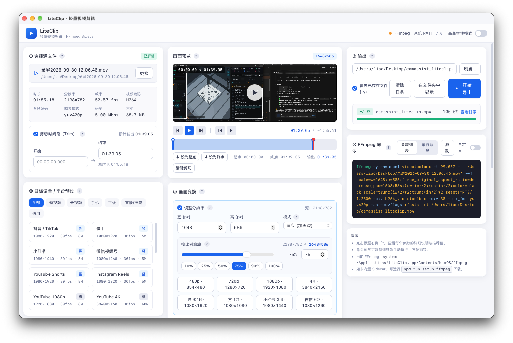

# LiteClip · 轻量视频剪辑工具

一款基于 **Tauri v2 + 原生 FFmpeg Sidecar** 的跨平台桌面视频剪辑应用。UI 简洁明快，内置通用设备尺寸预设与「高兼容性模式」，将常见 FFmpeg 参数封装为可视化控件，并实时展示等效命令，方便学习与排错。




## ✨ 特性

- 🎬 **可视化 FFmpeg**：剪切、缩放、旋转、变速、帧率、编码、音频、容器一站式配置
- 📱 **内置通用设备预设**：抖音 / 快手 / 小红书 / 视频号 / YouTube / B站 / iPhone / Android / iPad / RTMP 等
- 🛡️ **高兼容性模式**：一键切换到 `H.264 (High@4.0) + AAC 192kbps + yuv420p + MP4 + faststart`，几乎任何设备都能播
- 💡 **参数指导性提示**：每个控件旁都有「?」图标，悬停即可看到含义、推荐值、常用范围
- 🔍 **命令实时预览**：所见即所得，可一键复制到终端手动执行
- 🚀 **原生 Sidecar**：FFmpeg 二进制打包内置，无需用户安装
- 📈 **实时进度**：`-progress pipe:1` 解析 → 百分比、速度、fps、码率、输出体积
- ⏹️ **任务取消**：可随时中断正在执行的转码任务

## 🧱 技术栈

| 层 | 技术 |
| :-- | :-- |
| 桌面外壳 | Tauri 2 (Rust) |
| 前端 | React 18 + TypeScript + Vite + Tailwind CSS |
| 状态管理 | Zustand |
| 视频处理 | FFmpeg (Sidecar) + FFprobe |
| 异步/进程 | Tokio (process, io-util) |

## 📂 目录结构

```
liteclip/
├── src/                      # React 前端
│   ├── App.tsx               # 主布局
│   ├── components/           # 卡片式面板
│   ├── lib/                  # 类型 / 预设 / 时间工具 / 命令构建器
│   └── state/                # Zustand store
├── src-tauri/                # Rust 后端
│   ├── src/
│   │   ├── lib.rs            # 入口
│   │   ├── commands.rs       # Tauri commands & 参数构建（核心）
│   │   ├── ffmpeg.rs         # Sidecar 定位 & 异步执行 + 进度事件
│   │   ├── probe.rs          # ffprobe 元信息解析
│   │   └── state.rs          # 任务表
│   ├── binaries/             # ffmpeg / ffprobe Sidecar 位置
│   ├── capabilities/         # Tauri v2 权限
│   ├── icons/                # 应用图标
│   └── tauri.conf.json
└── scripts/
    └── setup-ffmpeg.sh       # 一键下载静态 FFmpeg 二进制
```

## 🚀 快速开始

### 1. 环境要求

- **Node.js** ≥ 18
- **Rust** ≥ 1.77（`rustup` 安装）
- 平台依赖（Tauri 官方要求）：
  - macOS：Xcode Command Line Tools
  - Windows：Microsoft Visual Studio C++ Build Tools + WebView2
  - Linux：`libwebkit2gtk-4.1-dev`, `libssl-dev`, `libgtk-3-dev`, `libayatana-appindicator3-dev`, `librsvg2-dev`

### 2. 安装依赖

```bash
npm install
```

### 3. 准备 FFmpeg Sidecar 二进制

> ⚠️ **重要**：Tauri Sidecar 要求 **静态构建**（不依赖 dylib / dll）。
> macOS 通过 Homebrew/conda 装的 ffmpeg 是动态链接的，**不能直接用作 Sidecar**。

自动下载（推荐）：

```bash
npm run setup:ffmpeg
```

手动放置：从以下渠道下载静态构建后，按平台命名放到 `src-tauri/binaries/`：

| 平台 | ffmpeg 命名 | ffprobe 命名 | 下载源 |
| :-- | :-- | :-- | :-- |
| macOS Apple Silicon | `ffmpeg-aarch64-apple-darwin` | `ffprobe-aarch64-apple-darwin` | [osxexperts.net](https://www.osxexperts.net/) |
| macOS Intel | `ffmpeg-x86_64-apple-darwin` | `ffprobe-x86_64-apple-darwin` | [evermeet.cx/ffmpeg](https://evermeet.cx/ffmpeg/) |
| Windows x64 | `ffmpeg-x86_64-pc-windows-msvc.exe` | `ffprobe-x86_64-pc-windows-msvc.exe` | [gyan.dev](https://www.gyan.dev/ffmpeg/builds/) / [BtbN](https://github.com/BtbN/FFmpeg-Builds) |
| Linux x64 | `ffmpeg-x86_64-unknown-linux-gnu` | `ffprobe-x86_64-unknown-linux-gnu` | [johnvansickle.com](https://johnvansickle.com/ffmpeg/) |

**开发调试便利**：即使没有 Sidecar，只要系统 PATH 中存在 `ffmpeg` / `ffprobe`，应用会自动回退使用系统版本，方便本地开发。UI 顶栏会用不同颜色标示当前使用的是「内置 Sidecar」还是「系统 PATH」。

### 4. 开发运行

```bash
npm run tauri:dev
```

首次运行 Rust 端会拉取依赖并编译，需要 3~8 分钟；之后启动仅需数秒。

### 5. 打包发布

```bash
npm run tauri:build
```

产物位置：`src-tauri/target/release/bundle/`
- macOS：`.dmg` / `.app`
- Windows：`.msi` / `.exe` (NSIS)
- Linux：`.deb` / `.AppImage` / `.rpm`

## 🎛️ UI 使用说明

界面按操作顺序分为 **6 张卡片**：

| # | 卡片 | 作用 |
| :- | :-- | :-- |
| ① | 选择源文件 | 拖放 / 浏览，自动 `ffprobe` 解析元信息；可勾选「剪切时间段」 |
| ② | 目标设备 / 平台预设 | 一键应用尺寸、帧率、码率、编码器、容器 |
| ③ | 画面变换 | Resize (fit/fill/stretch) / Rotate / Speed / FPS，均带开关，未启用不进入滤镜链 |
| ④ | 编码与容器 | 视频编码器、CRF / 固定码率、Preset、硬件加速、像素格式、音频编码器、容器、faststart |
| ⑤ | 输出 | 目标路径、覆盖开关、开始导出 / 取消、进度条与日志 |
| ⑥ | FFmpeg 命令预览 | 参数列表 & 单行命令，两种视图；可复制 |

顶栏右侧的「**高兼容性模式**」开关是一个"保险档"：
- 视频：H.264 (High Profile @ Level 4.0) + `yuv420p`
- 音频：AAC 192kbps / 48kHz / Stereo
- 容器：MP4 + `-movflags +faststart`
- 编码质量：CRF 23（视觉几乎无损、体积合理）

开启后，编码面板会锁定为兼容值；关闭则恢复自定义。

## 🧠 内置预设速查

**短视频**：抖音/TikTok、快手、小红书、微信视频号、YouTube Shorts、Instagram Reels
**长视频**：YouTube 1080p/4K、B站 1080p、Vimeo
**手机 / 平板**：iPhone 1080p、iPhone 4K (HEVC)、Android 1080p、微信朋友圈、iPad、Android 平板
**直播 / 推流**：RTMP 1080p / 720p
**通用**：720p / 1080p / 4K / 方形 1:1

每个预设都附带码率建议（参考各平台官方推荐值）。选中预设后仍可在下方面板微调。

## 🔌 Tauri Commands（前后端契约）

| 命令 | 参数 | 说明 |
| :-- | :-- | :-- |
| `ffmpeg_status` | — | 返回 `{ffmpeg, ffprobe}` 位置与版本 |
| `probe_media` | `{path}` | 返回 `MediaSummary`（时长/分辨率/编码/码率…） |
| `build_ffmpeg_args` | `{spec: JobSpec}` | 返回参数数组（用于校验/日志） |
| `run_ffmpeg` | `{taskId, spec}` | 异步执行，通过事件推送进度 |
| `cancel_task` | `{taskId}` | 发送 SIGTERM / taskkill 终止子进程 |
| `pick_input` / `pick_output` | — | 系统文件对话框 |
| `reveal_in_folder` | `{path}` | 在文件管理器中定位输出文件 |

**事件流**：

| 事件名 | 载荷 |
| :-- | :-- |
| `ffmpeg://progress` | `{task_id, seconds, percent, speed, fps, bitrate_kbps, size_kb, done}` |
| `ffmpeg://log` | `{task_id, line}` |
| `ffmpeg://done` | `{task_id, exit_code, success, tail[]}` |

## 🛠️ 常见问题

**Q1：为什么 macOS 打包后运行崩溃，提示找不到 dylib？**
A：Sidecar 使用了动态链接的 ffmpeg。请从 [evermeet.cx](https://evermeet.cx/ffmpeg/) 或 [osxexperts.net](https://www.osxexperts.net/) 下载**静态构建**替换。

**Q2：Windows 上杀毒软件误报？**
A：Tauri 打包 + FFmpeg 二进制在部分杀软下会被误报，请添加信任；发布版本建议做代码签名。

**Q3：`Copy` 模式为什么剪不干净？**
A：`-c:v copy` 不做重编码，只能在关键帧位置切割。若需要精确到帧的剪切，请关闭 Copy 模式。

**Q4：如何提升 H.265 兼容性？**
A：应用默认加上 `-tag:v hvc1`，让 QuickTime / Safari 能识别；如需更广泛兼容建议改用 H.264。

**Q5：4K 导出很慢？**
A：在「硬件加速」中选择 VideoToolbox (macOS) / NVENC (Win) / QSV (Intel) 可提速 3~10×。同码率画质略低于软编，可适度降低 CRF 补偿。

## 📄 许可

MIT © LiteClip Contributors

FFmpeg 是独立项目，遵循 LGPL/GPL；本项目不打包分发 FFmpeg 源码，仅通过用户自行运行 `scripts/setup-ffmpeg.sh` 或手动放置的方式引入静态二进制。分发前请自行确认 FFmpeg 二进制的许可与你的分发条款相容。
